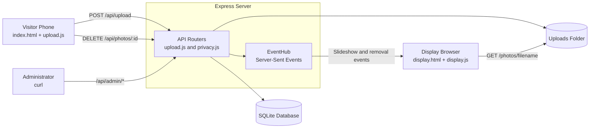
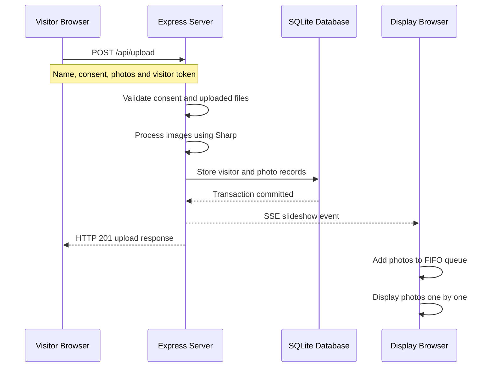
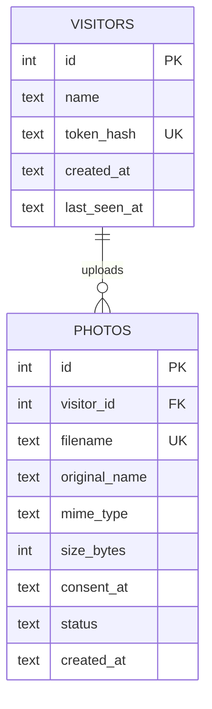

# Architecture – Visitor Photo Slideshow

## 1. Technology Stack and Design Choices

| Technology | Why it was selected | Trade-off |
|---|---|---|
| Node.js and Express | Lightweight backend and JavaScript throughout the application | Runs as a single server process |
| SQLite (better-sqlite3) | No separate database server required; supports transactions | Best suited to a single-server deployment |
| Multer (Memory Storage) | Allows uploaded files to be validated before saving them to disk | Memory usage is limited by the upload size and file count |
| Sharp | Decodes and re-encodes images, removes EXIF metadata and resizes large images | Requires a native dependency |
| Server-Sent Events (SSE) | Provides real-time, server-to-browser slideshow updates | Supports one-way communication |
| HTML, CSS and JavaScript | Simple frontend without a build process | Less structured than a frontend framework |
| Helmet and Rate Limiting | Provides security headers and limits repeated requests | Rate-limit information is stored in memory |
| Jest and Supertest | Automates testing of application logic and HTTP endpoints | Requires maintaining test cases |

## 2. System Architecture

The application follows a client-server architecture.

It has three main participants:

- **Visitor:** Uses a mobile phone to upload photos.
- **Express Server:** Validates uploads, manages visitors, stores photos and sends events.
- **Display:** A browser running on a television or computer that shows uploaded photos.

### Architecture Diagram

## 3. Upload Workflow

When a visitor uploads photos, the following process takes place:

1. The visitor opens the upload page.
2. The visitor enters their name and selects photos.
3. The visitor provides consent.
4. The browser sends a POST request to `/api/upload`.
5. The server checks consent, file type, file size and visitor information.
6. Sharp decodes and re-encodes the uploaded images.
7. Image metadata is removed and large images are resized.
8. The server stores the processed images and their database records.
9. After the database transaction succeeds, the EventHub broadcasts a slideshow event.
10. The display receives the event and adds the photos to its playback queue.
11. The visitor receives a successful upload response.

### Upload Sequence Diagram

## 4. Database Design

The application uses SQLite with two main tables:

### Visitors Table

Stores information about visitors.

| Column | Description |
|---|---|
| id | Primary key |
| name | Visitor's display name |
| token_hash | SHA-256 hash of the visitor token |
| created_at | Visitor registration timestamp |
| last_seen_at | Last visitor activity timestamp |

### Photos Table

Stores information about uploaded photos.

| Column | Description |
|---|---|
| id | Primary key |
| visitor_id | Foreign key referencing visitors |
| filename | Unique server-generated filename |
| original_name | Original uploaded filename |
| mime_type | Image MIME type |
| size_bytes | Processed image size |
| consent_at | Consent timestamp |
| status | Approved or removed |
| created_at | Photo upload timestamp |

### Entity Relationship Diagram

One visitor can upload multiple photos. Each photo belongs to one visitor.

## 5. Important Design Decisions

### Returning Visitor Recognition

The application generates a random visitor token and stores it in the browser's localStorage.

Only the SHA-256 hash of the token is stored in the database. This allows returning visitors to be recognized without storing their original token on the server.

### Secure Image Uploads

The application uses multiple validation steps:

- Mandatory consent verification.
- File size and file count restrictions.
- MIME type and file signature validation.
- Image decoding and re-encoding using Sharp.
- Image resizing.
- EXIF metadata removal.
- Random UUID-based filenames.

### Simultaneous Uploads

Multiple visitors can upload photos independently. Database transactions help maintain consistency, and unique filenames prevent filename conflicts.

The display uses a First-In, First-Out (FIFO) queue to show incoming photos one after another.

### Photo Removal

When a visitor deletes a photo, the application removes the corresponding image file and updates its database record.

The display receives a removal event so that a deleted photo can be removed from playback.

### Event Broadcasting

Slideshow events are broadcast only after the database transaction commits successfully.

This prevents the display from receiving an event for a photo that was not successfully saved.

### Frontend Security

The frontend uses `textContent` when displaying visitor-provided text to reduce the risk of cross-site scripting (XSS).

A Content Security Policy (CSP) restricts script execution to permitted sources and prevents inline JavaScript.

## 6. Known Limitations

The application has the following limitations:

- It is designed for a single-server deployment.
- SQLite is not intended for unrestricted horizontal scaling.
- Rate-limit information is stored in memory.
- Slideshow queues are maintained in browser memory.
- Photos uploaded while the display is closed are not automatically replayed later.
- Returning visitors are recognized through browser localStorage, so changing devices or clearing browser data creates a new visitor identity.

For additional details, refer to [ASSUMPTIONS.md](ASSUMPTIONS.md).